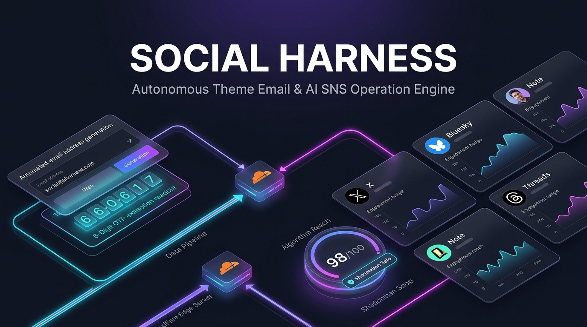

# Social Harness — Autonomous Theme Email Provisioning & Multi-SNS AI Operation Engine



**Social Harness** is a zero-cost, self-hosted theme-based SNS & Email automation engine built on **Cloudflare Workers + Cloudflare Email Routing (Email Workers) + D1 + Hono + MCP**.

It replaces expensive social media scheduling SaaS (Buffer, SocialDog, Hootsuite) and manual email alias management by combining:
1. **Zero-Cost Theme Email Auto-Provisioning**: Generates dedicated `*@your-domain.com` addresses per theme persona via Cloudflare Email Routing and automatically extracts **6-digit OTP verification codes & confirmation URLs** from incoming platform emails.
2. **AI Theme Persona Studio**: Defines target audience, tone, bio, and 3 content pillars from a single theme keyword.
3. **1-Source to Multi-SNS Thread Pipeline (X / Bluesky / Threads / note)**: Automatically separates external links into X self-replies to prevent the 50–80% external-link reach penalty on X.
4. **Shadowban & Algorithm Safety Auditor**: Audits hashtag density, spam trigger words, and reach score (0–100) before queuing posts.
5. **Built-in MCP Server**: Control email provisioning, OTP retrieval, and multi-SNS campaign generation directly from Claude Code or Cursor.

## Quick Start (5 Minutes)

```bash
git clone https://github.com/reina20xx/social-harness.git
cd social-harness
npm install
npm run db:init
npm run dev
```

Open `http://localhost:8804` in your browser.

## Run E2E Tests

```bash
npm run test:e2e
```

## License

MIT
